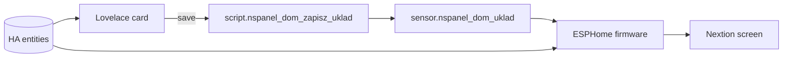

# NSPanel Dom – visual screen editor for Sonoff NSPanel (ESPHome + Nextion)

Drag-and-drop **layout editor** (Lovelace custom card, plain JS, no build step) for the
physical 480x320 screen of a Sonoff NSPanel running ESPHome. Design the home screen in
Home Assistant, press **Save to panel**, and the layout is pushed to the device.

> Status: early / personal project being opened up. Interfaces may change. Polish UI strings
> and entity names in places – translations and generalisation are welcome contributions.

## Features
- Live preview of the 24x16 grid (20 px cells) with real HA values
- Drag, swap, resize from any edge/corner; neighbours shrink automatically
- Tile types: weather+clock, weather, clock, value, value with bar, switch, climate, G13 tariff dial, house
- Entity suggestions, labels, per-tile options
- Preview font selection uses the same algorithm as the firmware (`f_fit`), so WYSIWYG

## How it works

## Repository layout
| Path | What |
|---|---|
| `dist/nspanel-dom-editor.js` | Lovelace card `custom:nspanel-dom-editor-card` (HACS entry) |
| `esphome/nspanel-dom.yaml` | Firmware (ESPHome) |
| `ha/nspanel_dom_ha.yaml` | HA package: layout sensor/scripts, catalog, weather feed |
| `display/nspanel_dom.tft` | Compiled Nextion display file |
| `docs/` | Notes and checklist |

## Install (short)
1. Copy `ha/nspanel_dom_ha.yaml` to `/config/packages/` (needs `homeassistant: packages:` enabled).
2. **HACS:** add this repository as a custom repository (category *Dashboard*), install, done.
   Manual: copy `dist/nspanel-dom-editor.js` to `/config/www/` and add it as a Lovelace resource
   (`/local/nspanel-dom-editor.js?v=1`, type *module*).
3. Copy `display/nspanel_dom.tft` to `/config/www/nspanel/`.
4. Copy `esphome/secrets.yaml.example` to `secrets.yaml`, fill it in, adjust `substitutions` in
   `esphome/nspanel-dom.yaml` (entities, `tft_url`) and flash.
5. Add the card: `type: custom:nspanel-dom-editor-card`.

## Languages
Editor UI: English, Polish, German, Ukrainian. Follows the HA UI language, or set `language: pl` in the card.
Add a language by copying the `en` block in `TR` (top of `dist/nspanel-dom-editor.js`) – a test checks key parity.

Card options: `language`, `g13_entity`, `dom_entity`, `layout_entity`, `catalog_entity`, `info_entity`, `save_script`.

## Languages (all parts)
- Editor card: en, pl, de, uk (follows HA)
- Panel screen: `language: pl|en` in the firmware substitutions (`esphome/nspanel_i18n.h`)
- HA-generated texts: `input_select.nspanel_dom_language` (pl/en)
- Details and what is intentionally not translated: `docs/TRANSLATING.md`

## Building the display file
No `.HMI` source is needed – the Nextion project is a blank page with fonts and touch code:
see `docs/BUILD-TFT.md` (or use the compiled `display/nspanel_dom.tft`).

## Known limitations
- Entity names created by the firmware (e.g. `Korytarz: zgaś po`), sound names and some code comments are still Polish (see `docs/TRANSLATING.md`).
- The firmware translation was checked for C++ syntax patterns only, not compiled on a device – please report issues.
- Default entities in the firmware/package are placeholders (`YOUR_*`) – replace them.

## Roadmap
- Split editor into modules with a pluggable tile-type registry
- More languages for the panel screen (needs matching Nextion fonts)
- Tile-type contribution guide
- CI: YAML + JS lint (workflows are in docs/ci/, to be enabled)

## Author
Tadeusz ([@tadzik1498](https://github.com/tadzik1498)) – created and maintained; contributions welcome.

## License
MIT
