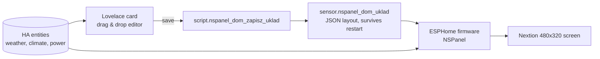

# [Custom card] NSPanel Dom – drag & drop screen editor for Sonoff NSPanel (ESPHome + Nextion), EN/PL/DE/UK

Design the NSPanel's main screen in your browser, press **Save to panel** – done.
No YAML editing, no reflashing for layout changes.

## What it does
- 24×16 grid preview of the real 480×320 screen with **live values** from your HA
- Drag to move, drop on another tile to **swap**, resize from any edge/corner (neighbours shrink)
- Tiles: weather + clock, value, value with bar, switch, climate, tariff dial (Polish G13), house (roof / indoor temp + climate + power bar)
- Preview uses the **same font-fitting algorithm as the firmware**, so what you see is what the panel shows
- UI in **English, Polish, German, Ukrainian** (follows the HA language; add yours in one block)

## How it works

## Languages
| Polski | Deutsch | Українська |
|---|---|---|
|  |  |  |

## Install
HACS → Custom repositories → `https://github.com/tadzik1498/nspanel-dom` (Dashboard) – then see the README for the HA package, firmware and TFT.

## Status / help wanted
Early release. Firmware and package texts are still Polish, the Nextion `.HMI` source is not published yet, tariff tile is Polish-market specific.
Feedback, translations and new tile types are very welcome: https://github.com/tadzik1498/nspanel-dom/issues
