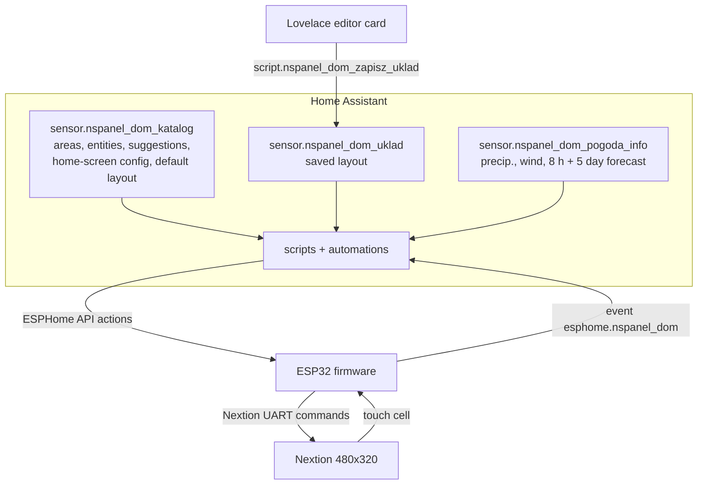

# How it works (in detail)

## 1. Two worlds, one rule: HA thinks, the ESP draws
The ESP32 has no list of rooms or entities compiled in. Everything it shows arrives from HA as
short text lines over the ESPHome API. The Nextion display holds only an empty page, five fonts
and a snippet that turns a touch into a *cell number* – every pixel is drawn by the ESP with
primitives (`fill`, `xstr`, `cirs`...).

## 2. The catalog (rooms → entities)
`sensor.nspanel_dom_katalog` (a trigger-based template sensor, refreshed on start, on area/floor
registry changes, every 15 min and on `nspanel_dom_rescan`) walks the registries and builds:
- `areas`: for each area its floor, entities, a *suggested* flag per entity and the state
- `glowny`: the home-screen configuration block (`ekran_glowny` in the package)
- `uklad_domyslny`: the default layout used until you save one in the editor

`script.nspanel_dom_sync` pushes this to the panel with the API actions
`begin` → `area` (once per area) → `done`, then the layout, the home screen and the forecast.
Sync runs when the panel connects, when the catalog changes and when the panel asks for it.
Afterwards an automation streams state changes (`state` action); the home screen is rate-limited
to one push per 2 s with the newest values.

On the panel you choose which entities appear per room (suggested / added / hidden) and can move
an entity to another room (**Edit**). That selection is stored in the ESP's flash
(`p_sel`, `p_mve`, `p_mva`), the layout itself is *not* – it is re-sent from HA whenever needed.

## 3. The layout and the editor
The home screen is a list of tiles on a **24 × 16 grid** (a cell is 20 px of the 480 × 320 screen):

    T|column|row|width|height|entity|label|option1|option2|extra

| T | Tile | option1 / option2 |
|---|---|---|
| W | weather + clock (option1 = 0 → weather only) | |
| C | clock | |
| V | value (option2 `g13` = tariff tile, `dom` = house tile) | decimals / unit |
| B | value with bar | bar min / max |
| T | switch / scene / script | |
| K | climate | |

Save flow: **editor card** → `script.nspanel_dom_zapisz_uklad` → fires an event that a trigger
template stores in `sensor.nspanel_dom_uklad` (survives restarts) → automation → 
`script.nspanel_dom_uklad_wyslij` converts the JSON into the text lines above (adding unit, label
and brightness) → API action `uklad` → the ESP redraws.

The editor's preview is not an approximation: font fitting (`f_fit`, Arial advance widths), sky
palette (by weather group and sun elevation), tile geometry and the tariff/house drawings are ports
of the firmware code. The *visible width* number entity corrects for the part of the screen hidden
by the NSPanel bezel.

## 4. Touch
The Nextion sends one number: `row * 16 + column` of a **16 × 16 touch grid** (30 × 20 px). The ESP maps
it to the tile under the finger (for tiles) or to buttons of the current view. Views: home screen,
rooms, edit, device control (light/switch/cover/fan/lock), climate control, forecast, message popup.
Touch semantics on the home screen: weather = forecast, climate / house = climate control,
switch = toggle, other tiles = rooms.

## 5. Tariff (G13) and house tiles
Both are normal V tiles whose entity carries a semicolon string (see `DATA-FORMAT.md`).
The tariff tile draws three rings: outer = a 24 h dial of today's zones with a "now" hand, middle =
saved vs paid against G11, inner = kWh per zone. The house tile draws a house: roof temperature on
the roof, indoor temperature inside, climate setpoint/mode/fan beside it and a power bar as the floor.

## 6. Messages and reminders
`script.nspanel_dom_wiadomosc` shows a popup (title, text, level, sound, blinking, auto-close,
second button). Button presses come back as the HA event `esphome.nspanel_dom` (`what: przycisk`,
`ident`). The hallway-light feature uses this: light on → popup "Turn off in N s" → countdown with Cancel
→ `homeassistant.turn_off`.

## 7. Languages
Three independent layers: editor card (`TR` table), panel screen (`nspanel_i18n.h`), HA-generated text
(`input_select.nspanel_dom_language`). See `TRANSLATING.md`.
