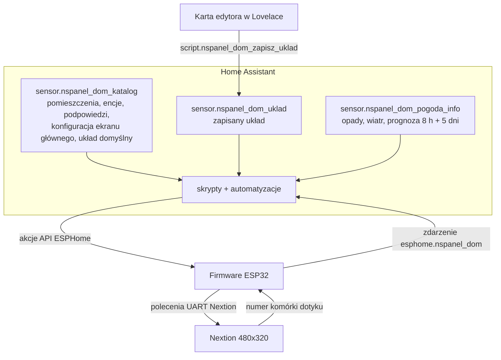

# Jak to działa (dokładnie)

## 1. Dwa światy, jedna zasada: HA myśli, ESP rysuje
W ESP32 nie ma wkompilowanej listy pokoi ani encji. Wszystko, co widać na ekranie, przychodzi z HA jako
krótkie linie tekstu przez API ESPHome. Wyświetlacz Nextion ma tylko pustą stronę, pięć fontów i fragment
kodu zamieniający dotyk na *numer komórki* – każdy piksel rysuje ESP prymitywami (`fill`, `xstr`, `cirs`...).

## 2. Katalog (pomieszczenia → encje)
`sensor.nspanel_dom_katalog` (sensor szablonowy wyzwalany zdarzeniami; odświeża się przy starcie, zmianach
w rejestrze pomieszczeń i pięter, co 15 minut oraz na zdarzenie `nspanel_dom_rescan`) przegląda rejestry i buduje:
- `areas`: dla każdego pomieszczenia piętro, encje, flagę *sugerowana* i stan,
- `glowny`: blok konfiguracji ekranu głównego (`ekran_glowny` w pakiecie),
- `uklad_domyslny`: układ domyślny, dopóki nie zapiszesz własnego w edytorze.

`script.nspanel_dom_sync` wysyła to na panel akcjami API `begin` → `area` (raz na pomieszczenie) → `done`,
a potem układ, ekran główny i prognozę. Synchronizacja działa po połączeniu panelu, przy zmianie katalogu
i na prośbę panelu. Potem automatyzacja przesyła na bieżąco zmiany stanów (akcja `state`); ekran główny
dostaje najwyżej jedną paczkę na 2 s, zawsze z najnowszymi wartościami.

Na panelu wybierasz, które encje mają się pokazywać w danym pokoju (sugerowane / dodane / ukryte) i możesz
przenieść encję do innego pomieszczenia (**Edytuj**). Ten wybór jest zapisany w pamięci flash ESP
(`p_sel`, `p_mve`, `p_mva`); sam układ ekranu *nie* – jest wysyłany z HA za każdym razem, gdy trzeba.

## 3. Układ ekranu i edytor
Ekran główny to lista kafelków na **siatce 24 × 16** (komórka = 20 px z ekranu 480 × 320):

    T|kolumna|wiersz|szerokość|wysokość|encja|podpis|opcja1|opcja2|dodatek

| T | Kafelek | opcja1 / opcja2 |
|---|---|---|
| W | pogoda + zegar (opcja1 = 0 → tylko pogoda) | |
| C | zegar | |
| V | wartość (opcja2 `g13` = taryfa, `dom` = domek) | miejsca po przecinku / jednostka |
| B | wartość z paskiem | min / max paska |
| T | przełącznik / scena / skrypt | |
| K | klimatyzacja | |

Droga zapisu: **karta edytora** → `script.nspanel_dom_zapisz_uklad` → zdarzenie, które sensor szablonowy
zapisuje w `sensor.nspanel_dom_uklad` (przetrwa restart) → automatyzacja →
`script.nspanel_dom_uklad_wyslij` zamienia JSON na linie tekstu (dokłada jednostkę, podpis i jasność) →
akcja API `uklad` → ESP przerysowuje ekran.

Podgląd w edytorze to nie przybliżenie: dopasowanie fontu (`f_fit`, szerokości znaków Arial), paleta nieba
(wg grupy pogody i wysokości słońca), geometria kafelków oraz rysunki taryfy i domku są przeniesione z kodu
firmware. Encja liczbowa *widoczna szerokość* koryguje część ekranu zasłoniętą przez ramkę NSPanel.

## 4. Dotyk
Nextion wysyła jedną liczbę: `wiersz * 16 + kolumna` na **siatce dotyku 16 × 16** (30 × 20 px). ESP przypisuje ją
do kafelka pod palcem (na ekranie głównym) albo do przycisków bieżącego widoku. Widoki: ekran główny,
pomieszczenia, edycja, sterowanie urządzeniem (światło/przełącznik/roleta/wentylator/zamek),
sterowanie klimatyzacją, prognoza, okno wiadomości. Na ekranie głównym: dotknięcie pogody = prognoza,
klimatyzacji i domku = sterowanie klimą, przełącznika = włącz/wyłącz, pozostałych kafelków = pomieszczenia.

## 5. Kafelki taryfy (G13) i domku
Oba to zwykłe kafelki V, których encja niesie napis rozdzielony średnikami (patrz `DATA-FORMAT.md`).
Kafelek taryfy rysuje trzy pierścienie: zewnętrzny = tarcza 24 h ze strefami na dziś i wskazówką „teraz",
środkowy = oszczędność względem G11 (zapłacone / zaoszczędzone), wewnętrzny = kWh w poszczególnych strefach.
Kafelek domku rysuje dom: temperatura zewnętrzna na dachu, wewnętrzna w środku, obok nastawa/tryb/nawiew
klimatyzacji, a podłoga to pasek mocy.

## 6. Wiadomości i przypomnienia
`script.nspanel_dom_wiadomosc` pokazuje okno (tytuł, treść, poziom, dźwięk, mruganie, automatyczne zamknięcie,
drugi przycisk). Naciśnięcia wracają do HA jako zdarzenie `esphome.nspanel_dom` (`what: przycisk`, `ident`).
Korzysta z tego funkcja światła na korytarzu: światło włączone → okno „Zgaś za N s" → odliczanie z Anuluj →
`homeassistant.turn_off`.

## 7. Języki
Trzy niezależne warstwy: karta edytora (tabela `TR`), ekran panelu (`nspanel_i18n.h`), teksty generowane przez
HA (`input_select.nspanel_dom_language`). Patrz `TRANSLATING.md`.
